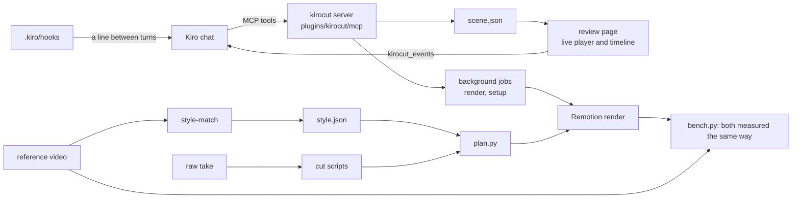

# Design: KiroCut, a Kiro-native video editor

## Overview

Kiro's chat is the editor's operator. It reads and changes a video through a local MCP server; the person watches in a
local web page (in the IDE's Simple Browser, the `kirocut-view` panel, or a browser tab); scripts do the measuring,
cutting and rendering. Everything runs on the person's laptop unless they pick a cloud render.

## Components

| Part | Where | What it does |
|---|---|---|
| MCP server | `plugins/kirocut/mcp/server.py`, `tools_*.py` | 22 tools; stdio JSON-RPC; private copies of the protocol pipes so child processes never touch them |
| Launcher | `mcp/launch.mjs` | finds the editor's venv, else `py -3`, else `python3`, so one `mcp.json` works on Windows and macOS |
| Events | `mcp/events.py`, `lib/kirocut/kirohook.py` | what the person pressed reaches the chat once; hooks add a line between turns and block tools after Stop |
| Live cut | `lib/kirocut/progress.py`, `review.py` `cut_steps`, `live_paper` | the scripts' steps go to the edit's own `review/steps.json`; the page reads them and strikes words as Kiro decides |
| Replay | `lib/kirocut/replay.py`, `kirocut_replay` | `review/replay.jsonl` plus Kiro's scene changes and the drafts, as a labelled time-lapse |
| Install | `plugin.json`, `mcp.json` (`${PLUGIN_ROOT}`), `tools.py` `first_run_setup`, `setup.py workspace` | one-click power; first status call installs the rest; one command for a clone |
| Benchmark | `tests/bench/bench.py` | measures any video with style-match's scripts and compares two styles field by field |
| Film grade | `look.py grade_of`, `plan.py grade_for`/`tone`, `edit.py grade_filter` | warm, shadows, contrast measured on both sides, pushed within limits, burned in with ffmpeg |
| Render proxies | `edit.py clip_proxy` | each clip a card plays, muted, at the output size, a keyframe every 15 frames |
| Examples | `lib/kirocut/examples.py`, `docs/examples/` | previews of edits made from footage anyone may publish, shown on Home and in the README |

## Decisions

- **MCP in the Python standard library**, not a framework: nothing to install before the tools exist, and the same Python
  the scripts use.
- **The page is a nicety; the chat is the source of truth.** Every page write is best effort and never stops a script.
- **Measure both sides with the same code.** A number from the reference and one from KiroCut's render mean the same
  thing, so the gap is real.
- **Long references are read in four spread windows** (look.py): reading text on every frame of a 15-minute video took
  hours on a laptop; four 45 s stretches from start to end take minutes and still see how it opens, goes on and ends.
- **Old names are migrated once, in one module** (`legacy.py`), not read in two forms everywhere.
- **Only publishable footage becomes an example.** A reference is measured locally and never stored in the repo.

## Testing

Every script has a `demo` self-check (listed in `tests/demos.txt`, run by `tests/run_demos.py` on Windows, macOS and
Linux in CI), `tests/check_plugins.py` checks the repo's rules, `tests/golden.py` pins the renderer's look per OS, and
`tests/run_evals.py` runs the agent's decisions through the Kiro CLI.
